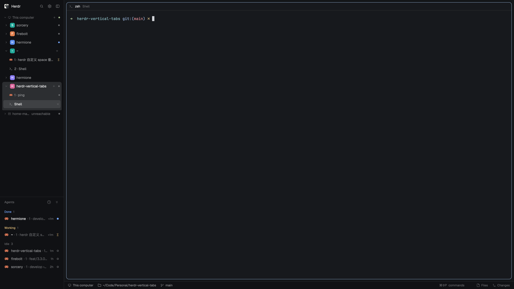

# Herdr — Vertical Tabs

A [Herdr](https://herdr.dev) layout that replaces the horizontal tab bar with a vertical directory tree: machines → spaces → tabs. Click a space and its tabs unfold underneath it.



## What it changes

- Machines, spaces and tabs form one tree in the left sidebar. Click a space to select it and expand its tabs; click the active space again to collapse it.
- The horizontal tab bar is gone. Only the shown space and its current tab are highlighted.
- Files and Changes toggle from the bottom-right status bar and are remembered per space.
- The bottom bar shows the focused terminal's folder and live git branch.
- The sidebar collapses to a 44px icon rail; the Herdr logo stays at the top and unfolds it.
- The Agents section collapses to a 28px summary row (`Working 2`, `Needs you 1`, `Done 2`, …) and gets its height back when expanded.

## Install

Copy the layout and mods into your Herdr home:

```sh
cp layouts/vertical-tabs.json ~/.config/herdr-app/layouts/
cp layouts/vertical-tabs.svg  ~/.config/herdr-app/layouts/
cp -R mods/* ~/.config/herdr-app/mods/
herdr-app do layout.switch --name vertical-tabs
```

The copy is additive: it only adds this layout and its six mods. Herdr redraws itself live, so no restart is needed.

Requirements: Herdr 0.1.15 or newer. The layout uses the shipped `files`, `changes` and `menu` mods, plus icons from the shipped `mods/workspace-chrome/`.

## Rebuild brief

[`RECIPE.md`](RECIPE.md) is the full brief for an agent building this from scratch: what you see, how it behaves, the layout node tree, each mod and its commands, caveats and acceptance checks.

## License

Apache-2.0. `agents-fold`, `chrome-fold`, `pane-cwdless` and `status-cwd` are derived from Herdr's shipped mods; `vertical-tabs` and `panel-toggles` are original.
