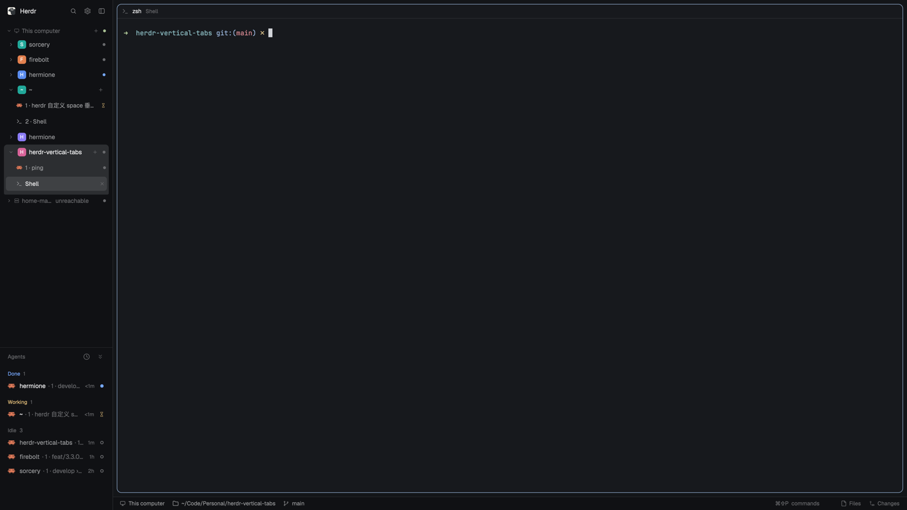

# Vertical Tabs

A Herdr layout that turns the left sidebar into a directory tree: machines, then spaces as folders, then tabs listed underneath the space they belong to. There is no horizontal tab bar; the tree is the only tab UI. Files and Changes open from the bottom right, and the bottom status bar shows the focused terminal's folder and live git branch.

## What you see

- **Top left:** the Herdr logo and name, then three icon buttons at the right: search, settings (gear), and collapse sidebar.
- **Sidebar tree**, top to bottom:
  - machine rows: a disclosure chevron, a monitor icon for this computer or a server icon for a remote machine, a bold machine name, the connection state when it is not connected (for example `unreachable`), a `+` for a new space there, and a 6px connection dot (green connected, gray not).
  - space rows: a chevron, an 18px rounded square in a stable color with the space name's first letter, the name, and a 6px agent-status mark. The shown space and all of its tab rows share one light `raised` card: the space row rounds the card's top corners, a 6px cap below the last tab rounds its bottom, and a collapsed active space is a single rounded row.
  - tab rows: the program icon, the tab name (or a terminal icon and name when it has no program), the agent-status mark, and a close × on the current tab. The current tab gets a nested `selected` pill inset inside the card. Tab rows are 34px tall, space rows 32px, machine rows 26px.
  - an expanded space has a single `+` at the right of its row that starts a new tab; it only appears while the space is expanded.
- **Agents section** under the tree: a header row with the title, a sort button (clock/layers), and a double-chevron button at the far right. Expanded, it lists agents grouped by priority or space. Collapsed, the header is 28px tall and shows a summary such as `Working 2` or `Needs you 1 Done 2`.
- **Main area:** one terminal card (or the active tab's split panes) with a 30px pane header: program icon, agent or program name, the tab's task name as a dim subtitle, blocked/done status, and split-right / split-down / zoom / close buttons on hover. There is no working spinner in the header; the tree and Agents list show progress.
- **Bottom left:** the Agents header when collapsed, exactly aligned with the bottom bar on its right.
- **Bottom right:** a 28px status bar with the machine, the focused folder (`~` for home), the live git branch, the palette shortcut hint, and Files / Changes toggles at the far right.
- **Collapsed sidebar (44px):** an icon-only rail: the Herdr logo at the top, then machine icons, space avatars, and tab icons arranged in one icon column and one status column. No `+` buttons are shown in the rail; clicking the logo unfolds the sidebar.

## How it behaves

- Click a machine row to fold or unfold its spaces. The local machine is shown first; remote machines are sorted by name.
- Click a space: if it is not the shown space, select it and expand its tabs; if it is already shown, collapse or expand it. Clicking its chevron only toggles. Several spaces can stay expanded.
- Click a tab to select its space and show it. Double-click a tab to rename it. Right-click a space or tab opens the shipped context menu.
- Only the shown space (with all of its tab rows, as one raised card) and its current tab (a nested `selected` pill) are highlighted; other spaces' remembered tabs stay as plain list rows.
- Status marks: a spinning ring means working; a 6px dot is blocked/done/idle in the corresponding theme color. A space shows its most urgent agent status; when the space is expanded its working spinner is hidden (its tab rows show the loading), while blocked/done marks stay.
- The `+` on a machine row appears only while hovering that row or when that machine holds the shown space. The `+` on a space row appears only while that space is expanded and is hidden in the 44px rail.
- Open spaces, folded machines, and folded machine groups persist per window in localStorage.
- Agents: click the header (or the chevron at its right) to collapse or expand. Collapsed, the layout block shrinks to 28px and the summary shows blocked/working/done counts (idle only when nothing else is present). The state and the last open height persist. In the 44px rail the section always stays open because the rail has no title row.
- Search opens Herdr's picker; the gear opens Settings; the sidebar button folds to 44px.
- Files / Changes: clicking one opens the right panel; clicking it again closes the panel; switching spaces restores that space's last panel choice (the choice is saved in the toggle mod's localStorage).
- The status bar follows the focused terminal: folder and branch update live. At home, no branch is shown.
- Pressing escape or using Herdr's own keys is unchanged: there is no `keys.json`.

## Built from

`layouts/vertical-tabs.json` — root is a `row`:

- column `sidebar` (280px, min 44, max 560, resizable, `chrome` background):
  - block `brand`, 46px, `window_drag: true`, mod `chrome-fold`.
  - block `tree`, weight 2, min 120, mod `vertical-tabs`.
  - block `agents`, weight 1, min 28, mod `agents-fold`.
- column `work`:
  - row `work-body`, padding 8, gap 8:
    - block `main`, `{ "tab": "active" }`, pane frame with `header` mod `pane-cwdless` (30px, top, reveal always), radius 10, gap 8, lone, background/border/focus.
    - column `panel`, hidden, 368px, min 280, max 900 → stack `panel-body` (`active: "files"`) with blocks `files` and `changes`.
  - row `bottom`, 28px: block `status` (weight 1, mod `status-cwd`) and block `panel-toggles` (170px).
- Root: `titlebar: "none"`, `traffic_lights: [12, 16]`, `background: "canvas"`, `terminal_padding: [14, 12]`, `preview: "layouts/vertical-tabs.svg"`.

Mods:

- `vertical-tabs` — the machine/space/tab tree. Reads `spaces()`, `panes()`, `machines()`, `theme()`, `shared()` / `setShared()`; uses `hc(["machine", "ls", "--json"])` every 15s for machine state; runs `space.select`, `space.new`, `tab.select`, `tab.new`, `tab.close`, `tab.rename`; opens the shipped `menu` overlay for right-clicks. localStorage: `vertical-tabs.open`, `vertical-tabs.machines`. Also maintains the shared `space.colors` map (one of `ansi6, ansi3, ansi4, ansi5, ansi2, ansi1` per space).
- `agents-fold` — a clone of the shipped `agents` mod (0.1.15) with a collapsible section header and the summary. It finds its own layout block by `content.mod` and calls `layout.resize` (px 28 when closed, the remembered weight/px when open). localStorage: `agents.closed`, `agents.size`. Shipped agent rows, pinned agents, sub-agent trees, sort menu and pin migration are unchanged.
- `chrome-fold` — a clone of `workspace-chrome` used as the brand bar: logo, search, settings, collapse; the collapsed rail shows the logo and folds to 44px (instead of the shipped 76px on macOS). No footer branch.
- `status-cwd` — a clone of `workspace-status` without the agents count, plus the focused terminal's folder and live branch. It keeps the palette-hint logic and the same 28px bottom-bar look.
- `pane-cwdless` — a clone of `pane` with the folder label and the working spinner removed; a spacer takes the folder's place. It shows the tab's task name (the tab name without its leading index) as a dim subtitle after the program name; unnamed tabs show none. Blocked and done marks stay.
- `panel-toggles` — Files / Changes buttons placed in the bottom bar; runs `layout.show` / `layout.hide` / `layout.select` on the `panel` and `panel-body` nodes and remembers one panel per space.

Shipped mods used as-is: `files`, `changes`, `menu`; many icons come from the shipped `mods/workspace-chrome/` assets, and `panel-toggles` uses `mods/files/file.svg` and `mods/changes/changes.svg`.

The artwork in `preview.png` is an abstract structural rendering of `layouts/vertical-tabs.svg`, not a real screenshot, so it contains no folders, spaces, agent names or terminal content.

## Watch out

- The layout's block ids are load-bearing: `sidebar`, `panel`, `panel-body` are found by name. `agents-fold` finds its block by `content.mod === "agents-fold"`; if you rename the mod, update `blockNode()`.
- The Agents block must allow a 28px height (`min` ≤ 28), otherwise the closed section is clamped.
- Icons are borrowed from shipped mods (`mods/workspace-chrome/*.svg`, `mods/files/file.svg`, `mods/changes/changes.svg`, `mods/pane/close.svg`). If a future Herdr renames them, update the paths.
- The cloned mods are derived from Herdr 0.1.15 and are licensed Apache-2.0 (see `LICENSE`); they can drift from a later shipped version.
- The 44px rail is narrower than the macOS traffic-light area, so the window buttons float over the top of the rail. Change the collapse target back to 76px (and the sidebar `min`) if that matters.
- `status-cwd` shows a branch only when the focused pane's live folder is in a git repo; the home space shows only `~`.
- There is no `keys.json`; everything uses Herdr's default shortcuts.
- `preview.png` is for the listing; `layouts/vertical-tabs.svg` is the smaller preview Herdr shows in Settings.

## Done when

- `herdr-app check` passes for every bundled mod (`vertical-tabs`, `agents-fold`, `chrome-fold`, `pane-cwdless`, `status-cwd`, `panel-toggles`).
- Copying `layouts/` and `mods/` into `~/.config/herdr-app` and running `herdr-app do layout.switch --name vertical-tabs` shows machine groups, spaces and tabs, with no horizontal tab bar.
- Clicking a space expands its tabs; clicking a tab shows it; only the shown space and its current tab are highlighted.
- Right-click on a space or tab opens a menu; double-clicking a tab renames it; the `+` on an expanded space starts a terminal in that space.
- The bottom bar shows the focused folder and branch, and Files / Changes open and close the right panel and are remembered per space.
- Collapsing the sidebar with the brand button gives a 44px icon rail with the Herdr logo still at the top; clicking the logo unfolds it.
- Collapsing Agents makes the block exactly 28px and shows a colored summary; expanding restores its previous height.
